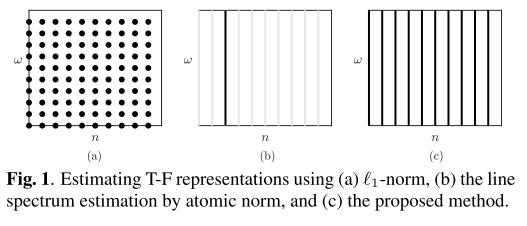
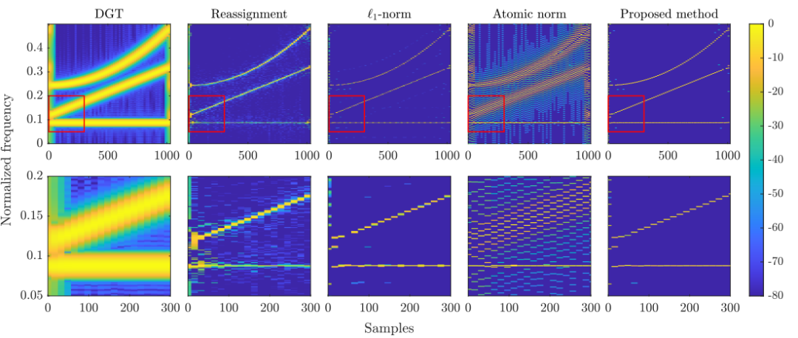
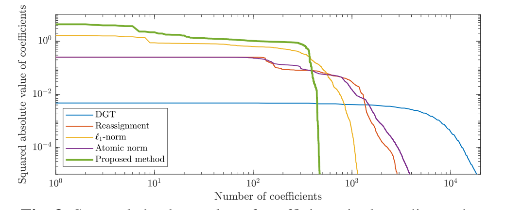
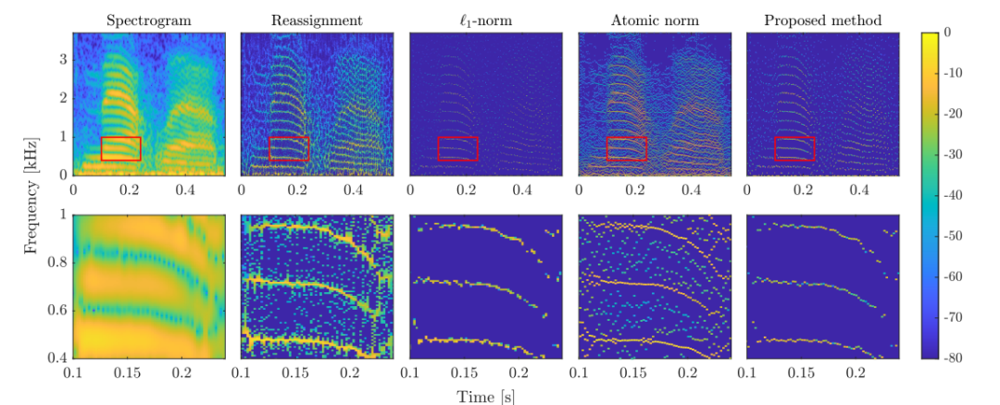
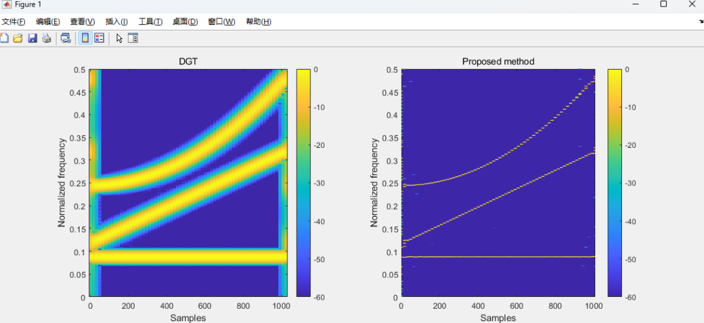

# Time-Frequency Analysis: Sparse Time-Frequency Representation Based on Atomic Mode Minimization [with MATLAB Code]

Introduction: Non-stationary signals are often analyzed and processed in the time-frequency (T-F) domain. To convert the time-domain signal into the T-F domain, short-time Fourier transform (STFT) or discrete Gabor transform (DGT) is typically utilized due to their simplicity and comprehensible structure [1, 2]. However, the T-F representation obtained from these methods is expanded due to windowing of the analyzed signal. This diffusion can affect the performance of T-F domain analysis and processing.
To obtain well-localized T-F representations, many methods have been proposed [3-14]. Redistribution and synchronization compression methods aim to relocate the extended components back to their original positions using phase derivative information [3-6]. Their performance is affected by the mixing of components due to windowing [15]. Sparseness-aware methods are a powerful tool that can effectively resist this component and noise mixing [7-14]. The purpose of sparseness-aware methods is to find the sparse solution for underdetermined systems. However, typical formulas based on 1-norm minimization involve discretizing continuous parameters onto a grid. Due to model mismatch between the signal and the predefined grid, performance may be compromised [16].
Recently, studies have focused on sparse optimization using atomic norms [17-20] and applied it to various applications, such as linear spectral estimation [21, 22], direction of arrival estimation [23-25], and target localization in radar [26]. Atomic norms do not require discretization of continuous parameters. Therefore, introducing atomic norms into sparse T-F representations can lead to better localized T-F representations.
This paper proposes an estimation method for sparse TF representations. Under the condition that the time-domain signal can be reconstructed, the estimation problem is cast as an atom norm minimization problem. Numerical experiments confirm that the proposed method provides a more sparse T-F representation than traditional methods.
Figure caption:
Conclusion: To address this issue, a sparse T-F representation estimation method based on minimizing atomic norms is proposed. Based on this method, it is possible to effectively estimate sparse T-F representations. This method utilizes the atomic norm to estimate sparse T-F representations without discrete frequencies. Theoretical analysis and experimental results indicate that the improved GVF method can estimate more sparse T-F representations. Future work includes applying this method to denoising and mode decomposition.
MATLAB Simulation Results

## Images

<!-- PAYMENT_BLOCK -->

## Get this dataset

- Payment link (Stripe): [Buy now](https://buy.stripe.com/3cs8yP7sY87d0vu9AB)
- Payment QR code: 

<!-- /PAYMENT_BLOCK -->
